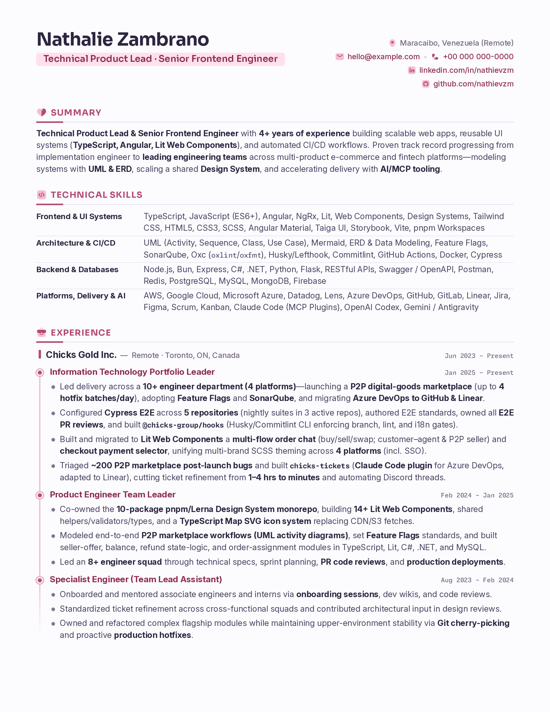
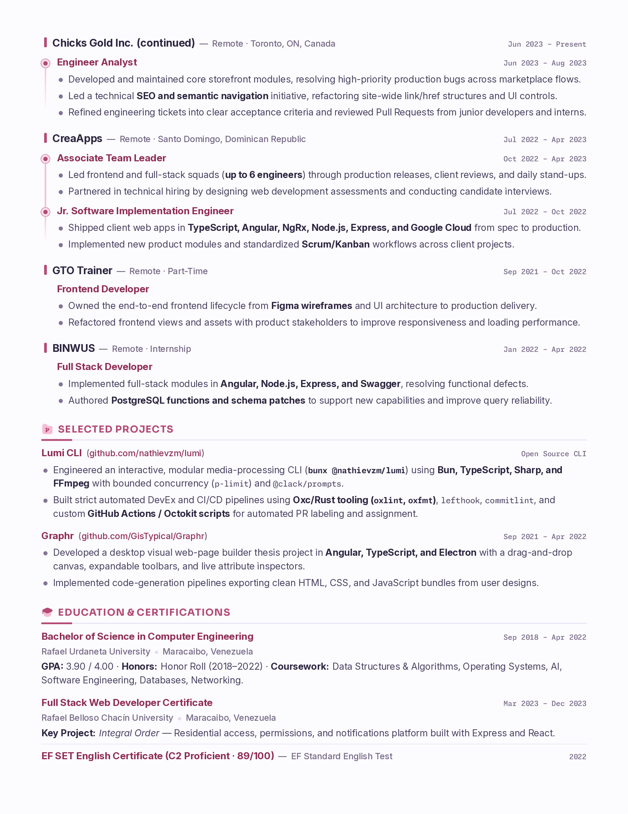

# 🎀 resume

My ATS-friendly software engineering résumé, built with **LuaLaTeX** and **LaTeX3 (`expl3`)** using a small modular design system (`styles` → `components` → `sections`) ✨

<p align="center">
  
  &nbsp;
  
</p>

## 🌸 overview

- **Modular structure:** Styles, reusable LaTeX3 components, and résumé content live in separate layers.
- **ATS-safe output:** Single-column reading order, `Ligatures=TeX` (keeps `fi`/`fl` searchable), no mid-word hyphenation, and local **Sora**, **Inter**, and **Monaspace Neon** font weights.
- **Vector icons, zero PUA glyphs:** Section and contact icons use 24×24 **Solar Bold Duotone** SVG paths via TikZ `svg.path`, avoiding replacement characters in PDF text extractors.
- **Typed setup (`l3keys`):** Paper size and vector icons are toggled from one `\Setup` block.
- **Privacy-friendly contact override:** Personal email and phone stay in a gitignored `src/contact.local.tex`, falling back to `src/contact.example.tex` on fresh clones.

## 🎨 structure & palette

```text
resume/
├── .vscode/settings.json    # 2-pass LuaLaTeX recipe (LaTeX Workshop) & LTeX+
├── docs/                    # Sanitized PNG previews for README
├── fonts/                   # Bundled Sora, Inter & Monaspace Neon weights
├── src/
│   ├── resume.tex           # Entry point & \Setup options
│   ├── contact.example.tex  # Public placeholder contact details
│   ├── contact.local.tex    # Private override (gitignored)
│   ├── styles/              # Config, colors, spacing, fonts, typography, layout
│   ├── components/          # Reusable layout macros & Solar SVG vector icons
│   └── sections/            # Content modules (summary, skills, experience, projects, education)
└── CONTRIBUTING.md
```

| Token | Hex | Usage |
| :--- | :--- | :--- |
| `PaperBg` | `#FCFBFE` | Warm-white page surface |
| `InkHeading` | `#2D2640` | Name, headings & emphasis |
| `InkPrimary` | `#4A4260` | Body copy & bullets |
| `BrandPrimary` | `#B34A74` | Section titles & primary icon layer |
| `BrandDeep` | `#8F2F56` | Role titles, links & hero badge text |
| `BrandSoft` | `#FFE0EC` | Hero role pill background |
| `BrandRule` | `#F5BDD4` | Section rules & secondary duotone layer |

## ⚙️ configuration

Edit `\Setup` in `src/resume.tex`:

| Option | Values | Default | Notes |
| :--- | :--- | :--- | :--- |
| `paper` | `letter` \| `a4` | `letter` | Page size (`letter` for US/Americas, `a4` for Europe) |
| `icons` | `true` \| `false` | `true` | Pure TikZ Solar Bold Duotone vector icons |

## 🛠️ building locally

Requires a TeX distribution with `lualatex` (for example [TinyTeX](https://yihui.org/tinytex/) or [TeX Live](https://tug.org/texlive/)) and, if editing in VS Code, the [LaTeX Workshop](https://marketplace.visualstudio.com/items?itemName=James-Yu.latex-workshop) extension.

```bash
git clone https://github.com/nathievzm/resume.git
cd resume

# optional: add your own private email/phone (gitignored)
cp src/contact.example.tex src/contact.local.tex
```

- **VS Code (recommended):** Open `src/resume.tex` and build with **LaTeX Workshop** — `.vscode/settings.json` already runs a 2-pass `LuaLaTeX` recipe with `autoClean` on build.
- **CLI:**

```bash
cd src
lualatex -interaction=nonstopmode resume.tex
lualatex -interaction=nonstopmode resume.tex
```

> [!TIP]
> Without `src/contact.local.tex`, the build automatically falls back to `src/contact.example.tex` so fresh clones compile cleanly out of the box.

To verify ATS text extraction after edits:

```bash
pdftotext src/resume.pdf - | head -n 60
```

---

🩷 [LinkedIn](https://www.linkedin.com/in/nathievzm/) · [GitHub](https://github.com/nathievzm)
